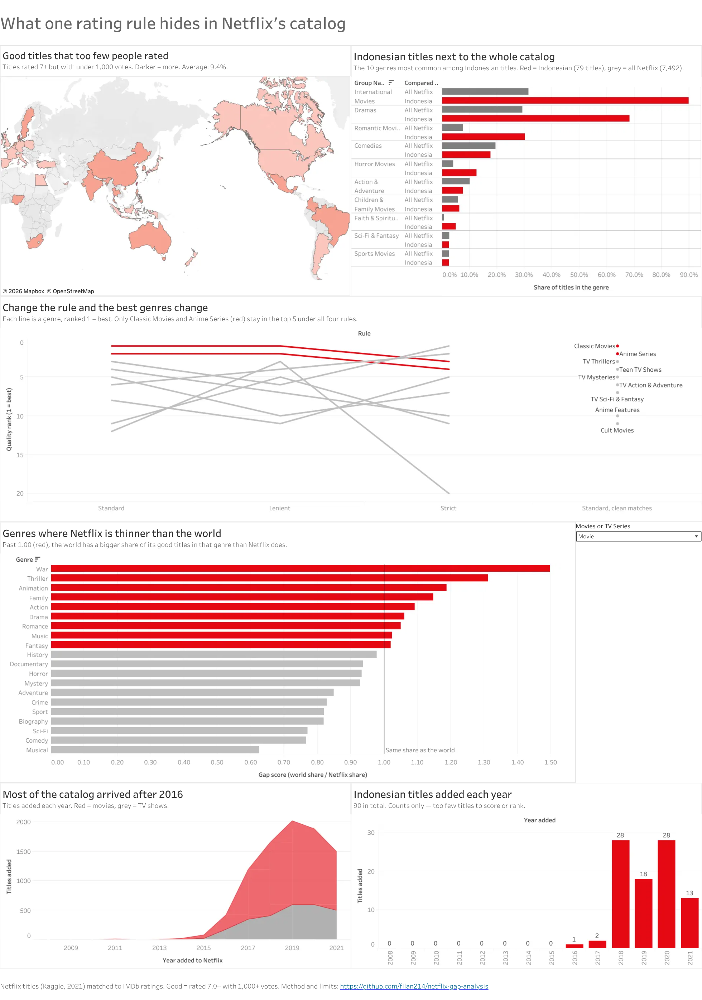

# Netflix Catalog vs IMDb Ratings

Interactive dashboard: [View on Tableau Public](https://public.tableau.com/app/profile/valentinus.gunawan/viz/NetflixsHiddenGemsWhatOneRatingRuleHidesintheCatalog/Netflixcatalogquality)

[](https://public.tableau.com/app/profile/valentinus.gunawan/viz/NetflixsHiddenGemsWhatOneRatingRuleHidesintheCatalog/Netflixcatalogquality)

Where does Netflix's catalog deliver titles audiences rate highly, where is it thin compared with the world, and how does Indonesian content compare? I matched Netflix's 2021 catalog to IMDb (Internet Movie Database) ratings and built a Tableau dashboard to answer these questions.

## Situation

The 2021 Netflix catalog (8,807 titles) has no signal of its own for how audiences rate its titles. IMDb ratings provide one, but the two datasets share no ID, so each title has to be matched to IMDb first.

## Task

Answer three business questions:

- Where does Netflix's catalog deliver audience-rated quality?
- Where is it thin compared with the world?
- How does Indonesian content compare?

## Action

- **Matched titles to IMDb** on normalized title, type and year, in two passes: exact year first (for series, the year must fall inside the show's run), then year off by one. Result: 7,492 of 8,807 titles matched (85.1%).
- **Audited match precision** on a sample of 60 matches, with AI (artificial intelligence) labelling and 12 rows checked by hand: exact-year matches 100.0% correct (30 of 30), year-off-by-one matches 96.7% (29 of 30).
- **Defined a "good" title** as IMDb 7.0 or higher with at least 1,000 votes. **Quality Score** = a group's share of good titles divided by the whole catalog's share, so 1.0 is the catalog average. Groups with fewer than 30 matched titles are not ranked.
- **Tested the genre ranking** under 4 rating rules: Standard (7.0 rating, 1,000 votes), Lenient (6.5, 500), Strict (7.5, 5,000), and Standard with uncertain matches removed.
- **Built 7 summary tables** with SQL (Structured Query Language) in PostgreSQL, run from Python.
- **Built a one-page Tableau dashboard** from those tables. A Python script generates the workbook.

## Result

- **Scale:** 8,807 Netflix titles, 7,492 matched to IMDb ratings, 2,142 rated "good" (IMDb 7.0+ with at least 1,000 votes).
- **Visibility penalty:** in some countries, many titles rated 7.0+ have fewer than 1,000 votes, so they never count as good. This share is highest in Taiwan (48.1%), then Singapore (23.5%) and Denmark (19.1%), against a catalog average of 9.4%. Indonesia is at 7.6%.
- **Rank instability:** change the rating rule and the top genres change. Only Classic Movies and Anime Series stay in the top 5 under all four rules, so the project reports this instability instead of a "top 5 genres" list.
- **Netflix vs the world:** War is the movie genre where Netflix is thinnest, with a Gap Score of 1.50. A Gap Score above 1 means the genre makes up a smaller share of Netflix's good movies than of the world's (IMDb titles from 2000 on).
- **Indonesia:** 90 titles, 79 of them matched. Shown as counts and percentages only, because there are too few titles to score or rank.
- **Known limit:** titles with no country listed match only 55.2% of the time, so "Unknown" is shown but not ranked.

## Dashboard

- **Map:** share of good-quality titles hidden by low votes, by country.
- **Indonesia vs all Netflix:** Indonesian titles next to the whole catalog, for the 10 most common Indonesian genres.
- **Rank stability:** genre ranks across the 4 rating rules.
- **Netflix vs world:** genres where Netflix is thinner than the world, with a Movie / TV (television) Series filter.
- **Catalog growth:** titles by year added to Netflix. Click a year to filter the Indonesia chart.
- **Indonesia growth:** Indonesian titles added by year.

## Limitations

- The catalog is a 2021 Kaggle snapshot, so everything is as of 2021.
- Netflix titles are matched to IMDb by title, type and year only. 14.9% of titles are unmatched, and titles with no country listed match at only 55.2%, against 76.9%-97.6% for named countries.
- The "good" threshold (7.0 rating, 1,000 votes) is a choice. Other thresholds change the top genre ranks, and the vote minimum hides well-rated titles from countries with fewer IMDb voters.
- Indonesia has only 90 titles, too few to score or rank.
- IMDb votes measure popularity, not Netflix viewership.

## Repo structure

```
dashboard/tableau/  netflix_dashboard.twbx (the dashboard), build_tableau.py
                    (generates it), netflix_map.twbx (map template it reads)
dashboard/data/     the 7 summary tables as CSV (comma-separated values) files,
                    netflix_gap_marts.xlsx and netflix_gap_marts_plain.xlsx
docs/               match report, audit sample, data profiles,
                    images/tableau_dashboard.png
notebooks/          profiling and cleaning of the Netflix data
scripts/            Python pipeline, run in order 01 to 05
sql/                schema, matching and summary-table queries
tests/              tests for title normalization
```

`dashboard/data/netflix_gap_marts.xlsx` is the pipeline output: the 7 summary tables, built from the raw data by `scripts/01` to `05`. `dashboard/data/netflix_gap_marts_plain.xlsx` holds the same tables with readable column names and is the input to `build_tableau.py`.

## How to open

Open the [dashboard on Tableau Public](https://public.tableau.com/app/profile/valentinus.gunawan/viz/NetflixsHiddenGemsWhatOneRatingRuleHidesintheCatalog/Netflixcatalogquality) in a browser. To open it offline, load `dashboard/tableau/netflix_dashboard.twbx` in Tableau Desktop or Tableau Public; the data is packaged inside the file.

## Rebuild

Needs Python 3.13 and PostgreSQL 14+. Run from the repo root in PowerShell.

1. Install: `python -m venv .venv; .venv\Scripts\Activate.ps1; pip install -r requirements.txt`
2. Create the database `netflix_gap`, copy `.env.example` to `.env`, and add your password.
3. Download `netflix_titles.csv` from [Kaggle](https://www.kaggle.com/datasets/shivamb/netflix-shows) and `title.basics.tsv` and `title.ratings.tsv` from [IMDb](https://datasets.imdbws.com/) into `data/raw/` (not committed).
4. Run `notebooks/02_clean.ipynb`, then `scripts/01_filter_imdb.py` to `scripts/05_export_xlsx.py` in order. This writes the summary tables to `dashboard/data/`. It does not yet write `netflix_gap_marts_plain.xlsx`.

### Rebuild the Tableau workbook

```powershell
python dashboard/tableau/build_tableau.py dashboard/data/netflix_gap_marts_plain.xlsx dashboard/tableau/netflix_map.twbx dashboard/tableau/netflix_dashboard.twbx
```

The generated file uses live CSV connections. Before publishing to Tableau Public, open it in Tableau, run Data → (each source) → Extract Data, then save.

## Tools

Python (pandas), PostgreSQL, SQL, Tableau.

## Sources

- [Netflix Movies and TV Shows](https://www.kaggle.com/datasets/shivamb/netflix-shows) (Kaggle)
- [IMDb non-commercial datasets](https://datasets.imdbws.com/): `title.basics` and `title.ratings`

IMDb data is licensed for non-commercial use only, so raw IMDb data is not redistributed in this repo. Only aggregate tables are committed.
