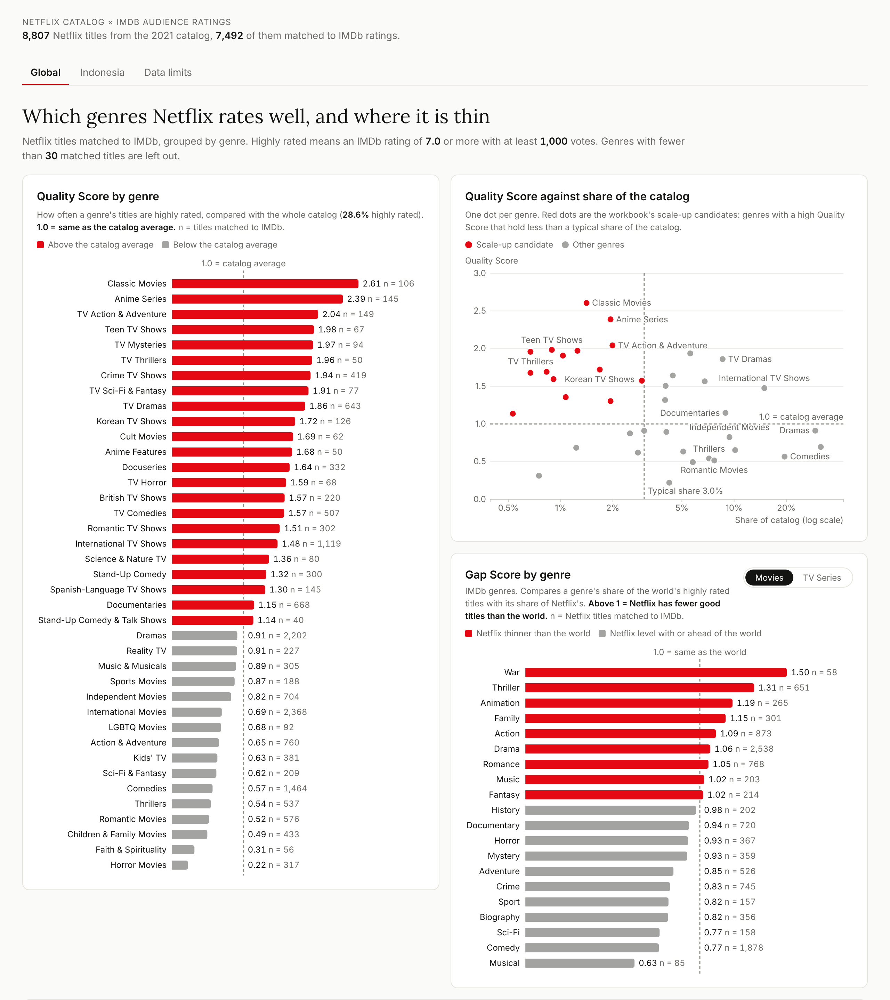
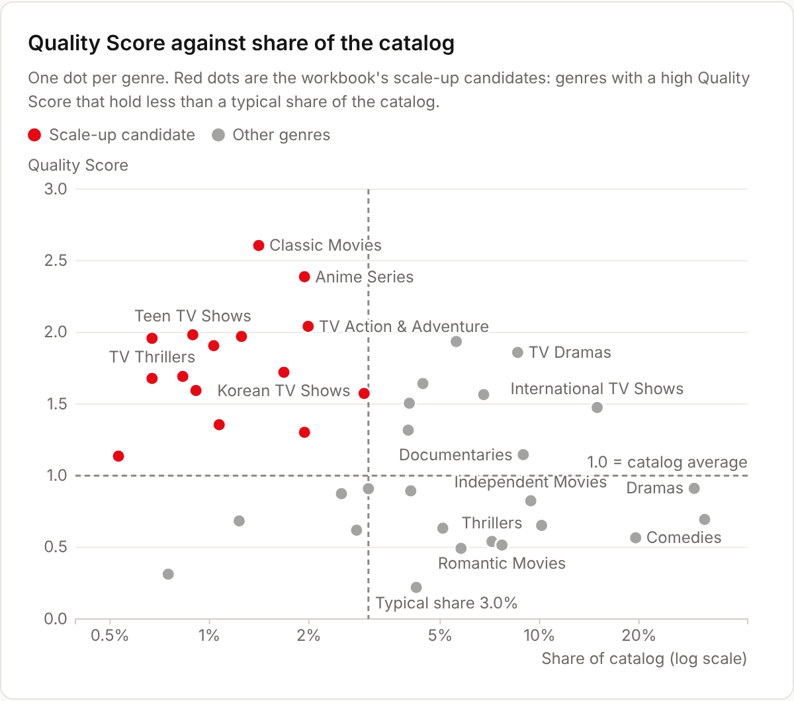
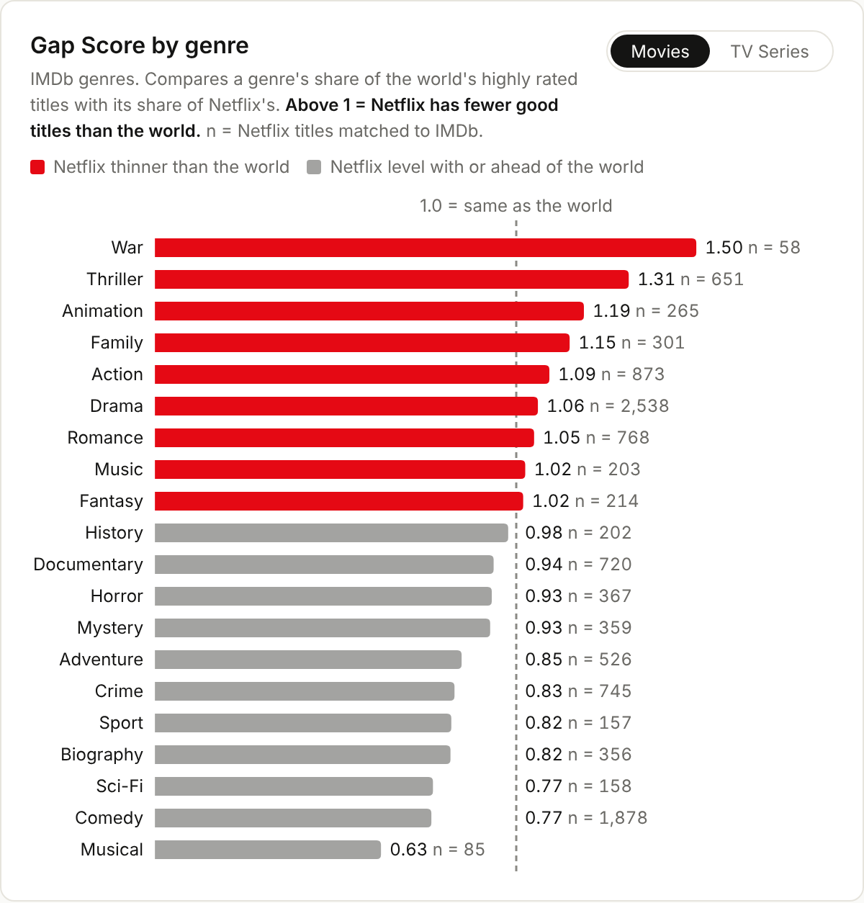
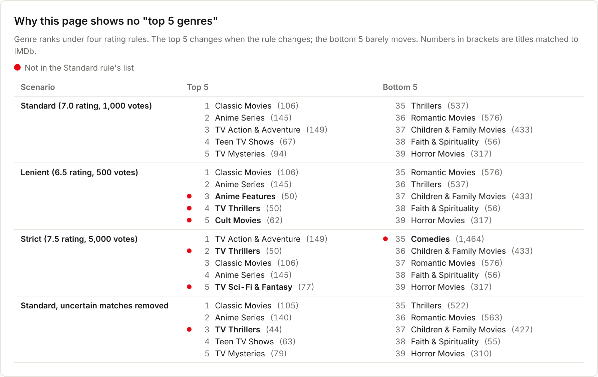
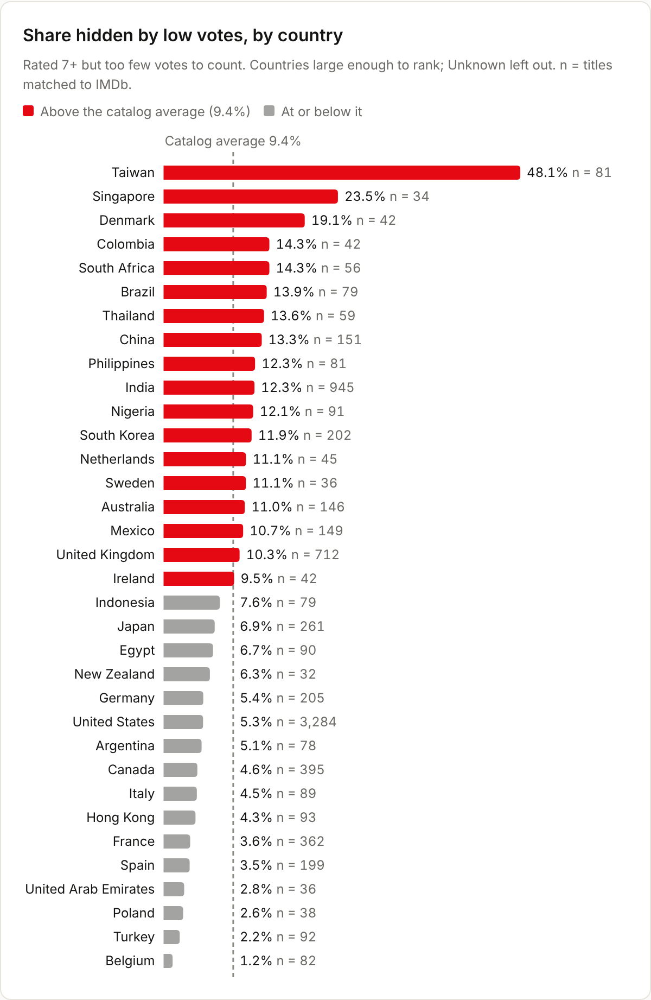
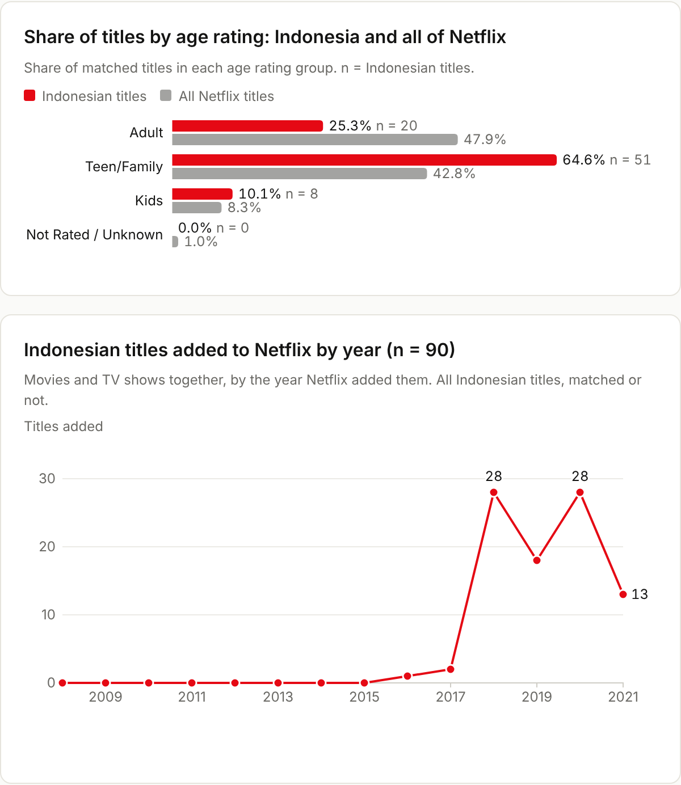

# Netflix Catalog vs IMDb Ratings

Where does Netflix's catalog deliver titles audiences rate highly, where is it thin compared with the world, and how does Indonesian content compare? I matched Netflix's 2021 catalog to IMDb (Internet Movie Database) ratings and built an Excel dashboard to answer these questions.


*Global view: Quality Score by genre, genre share against score, and the Gap Score against the world.*

## Situation

The 2021 Netflix catalog (8,807 titles) has no signal of its own for how audiences rate its titles. IMDb ratings provide one, but the two datasets share no ID, so each title has to be matched to IMDb first.

## Task

Answer three business questions:

- Where does Netflix's catalog deliver audience-rated quality?
- Where is it thin compared with the world?
- How does Indonesian content compare?

## Action

- **Matched titles to IMDb** on normalized title, type and year, in two passes: exact year first (for series, the year must fall inside the show's run), then year off by one. Result: 7,492 of 8,807 titles matched (85.1%).
- **Audited match precision** on a sample of 60 matches, with AI (artificial intelligence) labelling and 12 rows checked by hand: exact-year matches 100.0% correct (30 of 30), year-off-by-one matches 96.7% (29 of 30).
- **Defined "highly rated"** as IMDb 7.0 or higher with at least 1,000 votes: 2,142 titles, 28.6% of matched titles. **Quality Score** = a group's share of highly rated titles divided by the whole catalog's share, so 1.0 is the catalog average. Groups with fewer than 30 matched titles are not ranked.
- **Tested the genre ranking** under 4 scenarios: Standard (7.0 rating, 1,000 votes), Lenient (6.5, 500), Strict (7.5, 5,000), and Standard with uncertain matches removed.
- **Built 7 summary tables** with SQL (Structured Query Language) in PostgreSQL, run from Python. Then built an Excel dashboard with 3 pages (Global, Indonesia, Data Limits). Its charts are fed by dynamic-array formulas (FILTER, XLOOKUP, UNIQUE), the gap chart has a Movie / TV (television) Series dropdown, and check cells confirm the key numbers.

## Result

### 15 genres are small but rated well above average


*15 scale-up candidates: genres that score at least 1.1 (10% above the catalog average) but each hold less than the typical 3.0% share of the catalog.*

### Netflix is thinnest on War and Thriller movies


*For movies, the biggest gaps against the world are War (1.50) and Thriller (1.31). A Gap Score above 1 means the genre makes up a smaller share of Netflix's highly rated movies than of the world's (IMDb titles from 2000 on).*

### The top of the genre ranking is unstable, the bottom is not


*The top 5 changes under every alternative scenario, while four of the bottom five stay in the bottom five under all four. So the project makes no "top 5 genres" claim.*

### Low vote counts hide well-rated titles in some countries


*In Taiwan, 48.1% of matched titles are rated 7 or higher on IMDb but have fewer than 1,000 votes, so they do not count as highly rated.*

### Indonesian titles lean Teen/Family and arrived mostly in 2018-2020


*79 of 90 Indonesian titles matched. 64.6% are rated Teen/Family, against 42.8% across Netflix, and 74 of the 90 were added in 2018-2020. Descriptive only: Indonesia gets no scores or ranks.*

## Data limits

- Titles with no country listed match only 55.2% of the time, against 76.9%-97.6% for named countries, so "Unknown" is shown but not ranked.
- Titles added in 2011-2014 match worse (66.7%-75.0%) than those added from 2015 on (81.1%-88.3%). Only 51 titles were added in 2011-2014.
- IMDb votes measure popularity, not Netflix viewership.
- Netflix's genre labels and IMDb's genre labels are never compared directly. The gap against the world uses IMDb genres on both sides.
- Everything is as of the 2021 catalog.

## Repo structure

```
excel/              netflix_gap_marts_plain.xlsx: the dashboard workbook
images/             dashboard images used in this README
dashboard/data/     the 7 summary tables as CSV (comma-separated values) files,
                    plus netflix_gap_marts.xlsx built from them
notebooks/          profiling and cleaning of the Netflix data
scripts/            Python pipeline, run in order 01 to 05
sql/                schema, matching and summary-table queries
docs/               match report and audit sample
tests/              tests for title normalization
```

`dashboard/data/netflix_gap_marts.xlsx` is the pipeline output: the 7 summary tables, built from the raw data by `scripts/01` to `05`. `excel/netflix_gap_marts_plain.xlsx` is the Excel dashboard, built on the same tables.

## How to open

Open `excel/netflix_gap_marts_plain.xlsx` in Excel for Microsoft 365 or Excel 2024. Older versions lack the dynamic-array functions the dashboard uses and show `#NAME?`. The dashboard is on sheets 1 Global, 2 Indonesia and 3 Data Limits. The 7 data sheets come after them.

## Rebuild

Needs Python 3.13 and PostgreSQL 14+. Run from the repo root in PowerShell.

1. Install: `python -m venv .venv; .venv\Scripts\Activate.ps1; pip install -r requirements.txt`
2. Create the database `netflix_gap`, copy `.env.example` to `.env`, and add your password.
3. Download `netflix_titles.csv` from [Kaggle](https://www.kaggle.com/datasets/shivamb/netflix-shows) and `title.basics.tsv` and `title.ratings.tsv` from [IMDb](https://datasets.imdbws.com/) into `data/raw/` (not committed).
4. Run `notebooks/02_clean.ipynb`, then `scripts/01_filter_imdb.py` to `scripts/05_export_xlsx.py` in order. This writes the summary tables to `dashboard/data/`.
5. Open `excel/netflix_gap_marts_plain.xlsx`.

## Tools

- Python and PostgreSQL (SQL) for cleaning, matching and building the summary tables
- Excel for Microsoft 365 for the dashboard

## Sources

- [Netflix Movies and TV Shows](https://www.kaggle.com/datasets/shivamb/netflix-shows) (Kaggle)
- [IMDb non-commercial datasets](https://datasets.imdbws.com/): `title.basics` and `title.ratings`

IMDb data is licensed for non-commercial use only, so raw IMDb data is not redistributed in this repo. Only aggregate tables are committed.
